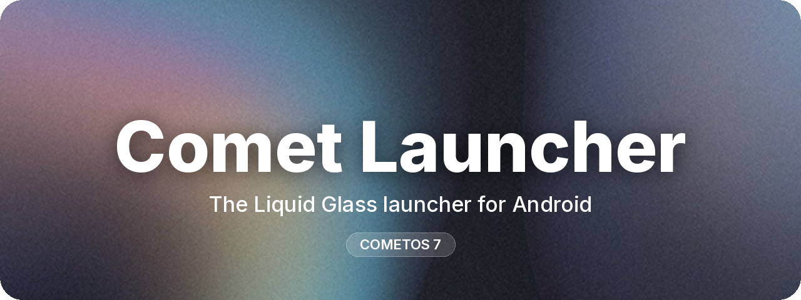

 

⭐ Enjoying Comet? A star helps the project grow.

---

### ☄️ About

**Comet Launcher** is a home screen for Android that feels like a whole new system.
Together with its lock screen, Control Center and App Library it forms **CometOS** —
one design language, one material: **Liquid Glass**. No root, no flashing: install it and set it as your Home.

### 🧊 What makes it different

- **Liquid Glass, for real** — every surface bends and lights what is behind it, from the dock to the notifications
- **Built for motion** — springs, bounces and 120 Hz animations are part of the design, not an extra
- **One look everywhere** — Home, lock screen, Control Center and settings speak the same language
- **Yours** — clocks, widgets, wallpapers, icons and layouts can all be changed
- **Private** — no ads, no tracking

### 📱 Inside CometOS 7

| | |
|:--|:--|
| 🏠 **Home & App Library** | Pages, folders, widgets and a library that sorts your apps for you |
| 🔒 **Lock Screen** | Glass clocks, depth effect, widgets, always-on display and its own editor |
| 🎛️ **Control Center** | Toggles, sliders, music player and a notification centre one swipe away |
| 🔔 **Notifications** | A stack that unfolds into a fluid list and gently presses the clock |
| 🏝️ **Dynamic Island** | Live activities floating over every app |
| ✨ **Comet AI** | An assistant built right into the Home |

### 🗺️ Status

CometOS is in **beta**. Builds are tested on real phones every week and shared with the community first.
Follow the channels below for new versions, previews and test access.

### 🤝 Get involved

Comet Launcher is **closed source**, but help is always welcome:
**testers**, **designers** and **Android developers (Kotlin · Jetpack Compose)**.
Say hi on Discord or Telegram.

---

**[Discord](https://discord.gg/e6wDCtXQFW)** · **[Telegram](https://t.me/comet_tech)** · **[TikTok](https://tiktok.com/@come1os)**

© 2026 Comet Team · Closed source · All rights reserved

