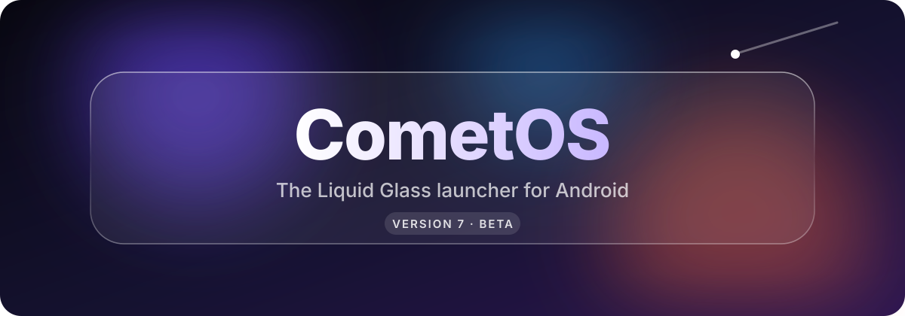
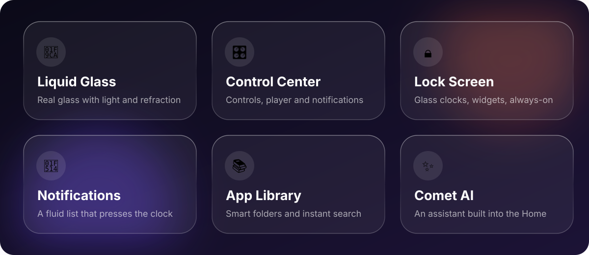

 

⭐ If you like Comet, leave a star — it really helps

 

**Comet Launcher** turns any Android phone into **CometOS**: a new Home, lock screen and Control Center,
all made of one fluid **Liquid Glass** — no root needed.

 

**Beta** · new builds and test access on Discord and Telegram

© 2026 Comet Team · Closed source · All rights reserved

